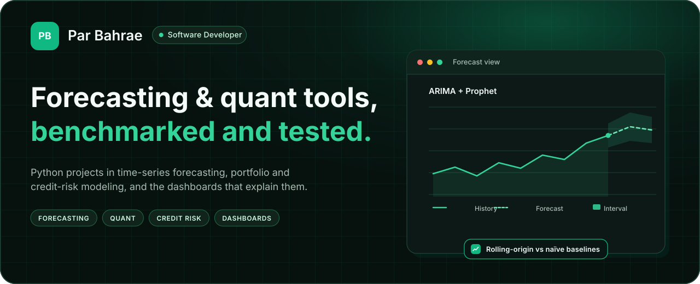

<picture>
  <source media="(prefers-color-scheme: dark)" srcset="assets/header-dark.svg">
  <source media="(prefers-color-scheme: light)" srcset="assets/header-light.svg">
  
</picture>

  
  

  Software developer building practical tools in Python, SQL, and AI. 
  Time-series forecasts, portfolio and credit-risk models, and dashboards that explain the results. 
  Forecasts and valuations are checked against naïve baselines or simple benchmarks, and committed results are pinned by tests.

<b>Seeking: Quantitative Analyst · Data Analyst · Forecasting / Valuation Analyst</b> · Toronto

## About me

- 🔭 **I’m currently working on** Python projects for financial analysis: a DCF valuation model built from SEC filings, an equity research pitch, an energy-sector research explorer, and a commodity price forecaster. My focus is on reproducible analysis, meaningful benchmarks, and clear explanations of results.
- 🌱 **I’m currently learning** advanced time-series methods, walk-forward validation, portfolio risk management, and explainable machine learning for credit-risk assessment.
- 👯 **I’m looking to collaborate on** time-series forecasting, quantitative research, and interactive data dashboards that turn complex datasets into practical insights.
- 🤔 **I’m looking for help with** strengthening model validation, preventing data leakage, and incorporating realistic assumptions into financial backtests. I welcome thoughtful code reviews and feedback from experienced practitioners.
- 💬 **Ask me about** evaluating forecasts against naïve baselines, exploring portfolio allocation trade-offs, and building Streamlit dashboards to communicate analytical results.
- 📫 **How to reach me:** [githubproproject@proton.me](mailto:githubproproject@proton.me) or [LinkedIn](https://www.linkedin.com/in/parbahrae/).
- ⚡ **Fun fact:** I also tutor mathematics and science, and breaking down complex ideas is a skill I bring to both teaching and data analysis.

## Featured projects

<table>
  <tr>
    <td width="50%" valign="top">
      <a href="https://github.com/ParBproject/dcf-valuation-model"> <b>DCF Valuation Model</b></a>  
      Reproducible DCF for AAPL, MSFT, KO, JNJ, CAT and XOM from SEC EDGAR XBRL filings, with sensitivity grids, a 10,000-draw Monte Carlo, a reverse DCF and a React dashboard where every assumption is a slider. 
      The TypeScript engine matches the Python results to 0.01%; a calibration review explains why AAPL, MSFT and CAT value well below market instead of tuning it away.  
      <a href="https://parbproject.github.io/dcf-valuation-model/">Live demo</a>
      &nbsp;·&nbsp;
      <code>Python</code> <code>TypeScript</code> <code>React</code>
    </td>
    <td width="50%" valign="top">
      <a href="https://github.com/ParBproject/stock-pitch"> <b>UNH Stock Pitch</b></a>  
      Long pitch on UnitedHealth built like a quant research project: frozen, hash-checked data, DCF and reverse DCF, a factor model, a walk-forward backtest and an interactive web deck. 
      Base-case value $526.64 vs $367.08 as-of price; the risks section shows the call flips to $321.29 with the full-sample beta.  
      <a href="https://parbproject.github.io/stock-pitch/">Live demo</a>
      &nbsp;·&nbsp;
      <code>Python</code> <code>JavaScript</code>
    </td>
  </tr>
  <tr>
    <td width="50%" valign="top">
      <a href="https://github.com/ParBproject/energy-sector-deep-dive"> <b>Energy Sector Deep Dive</b></a>  
      Point-in-time research on how 18 US oil &amp; gas companies in five segments trade against oil since 2015, with a linked React + ECharts explorer and an oil-scenario tool. 
      Producers carry the highest oil beta (0.55 per 1% WTI move) vs 0.27 for refiners; producers fell 78.7% in the 2020 crash.  
      <a href="https://parbproject.github.io/energy-sector-deep-dive/">Live demo</a>
      &nbsp;·&nbsp;
      <code>Python</code> <code>TypeScript</code> <code>ECharts</code>
    </td>
    <td width="50%" valign="top">
      <a href="https://github.com/ParBproject/commodity-price-forecaster"> <b>Commodity Price Forecaster</b></a>  
      Nine energy, metals and agriculture futures forecast with ARIMA and Prophet, scored in a 52-week rolling-origin leaderboard against naïve baselines. 
      A simple baseline won: Drift, average MASE 2.204, effectively tied with Naive; ARIMA and Prophet did not beat it at one week.  
      <a href="https://parbproject.github.io/commodity-price-forecaster/">Live demo</a>
      &nbsp;·&nbsp;
      <code>Python</code> <code>Streamlit</code> <code>Prophet</code>
    </td>
  </tr>
  <tr>
    <td width="50%" valign="top">
      <a href="https://github.com/ParBproject/Advanced-Financial-Models"> <b>Advanced Financial Models</b></a>  
      Excel workbook plus a tested Python package for cash-flow forecasts, credit expected loss, portfolio risk and stress tests. 
      Regression tests pin a credit example: $100,000 × 15% PD × 45% LGD = $6,750 expected loss.  
      <code>Python</code> <code>Excel</code> <code>Streamlit</code>
    </td>
    <td width="50%" valign="top">
      <a href="https://github.com/ParBproject/stock-price-predictor"> <b>Stock Price Predictor</b></a>  
      Next-day stock forecasts with LSTM and Random Forest, leakage-safe evaluation and Backtrader backtests. 
      Benchmarked against a naïve persistence baseline.  
      <code>Python</code> <code>TensorFlow</code> <code>Backtrader</code>
    </td>
  </tr>
  <tr>
    <td width="50%" valign="top">
      <a href="https://github.com/ParBproject/Portfolio-Optimizer"> <b>Portfolio Optimizer</b></a>  
      Markowitz mean-variance optimizer in CVXPY: efficient frontier, max-Sharpe and min-variance portfolios, an equal-weight backtest and a Streamlit UI. 
        
      <code>Python</code> <code>CVXPY</code> <code>Streamlit</code>
    </td>
    <td width="50%" valign="top">
      <a href="https://github.com/ParBproject/AI-Investment-Dashboard"> <b>AI Investment Dashboard</b></a>  
      Streamlit dashboard for an efficient frontier, Monte Carlo paths, Black–Scholes option pricing and what-if scenarios. 
        
      <code>Python</code> <code>Plotly</code> <code>Streamlit</code>
    </td>
  </tr>
</table>

  
  
  

## More repositories

- **[SkyCast](https://github.com/ParBproject/skycast)** — Installable weather and air-quality PWA on Open-Meteo: vanilla JavaScript, offline caching, Node and Python tests. [Live demo](https://parbproject.github.io/skycast/)
- **[Stroke](https://github.com/ParBproject/Stroke)** — Holdout study of the Kaggle stroke dataset: logistic regression versus tree models, calibration, and threshold choice. [Live casebook](https://parbproject.github.io/Stroke/)
- **[Generative AI Data](https://github.com/ParBproject/Generative-AI-Data)** — Browser demos for in-browser transformer sentiment, fraud exploration, a churn what-if, and data storytelling. [Live demos](https://parbproject.github.io/Generative-AI-Data/)
- **[Order fulfillment](https://github.com/ParBproject/E-commerce-Order-Fulfillment-Process-Improvement)** — Warehouse fulfillment case study on synthetic data: DuckDB SQL marts, window functions, and a before/after KPI board.
- **[Credit-risk case study](https://github.com/ParBproject/Portfolio-Risk-Analysis-Credit-Risk-Modeling)** — Written analysis of a synthetic 1,000-loan portfolio: default probability, stress tests, and a risk report.
- **[Stock screener and backtester](https://github.com/ParBproject/-Stock-Screener-Strategy-Backtester-Insider-Institutional-Signal-Tracker-)** — Streamlit equity research app for fundamental and technical screening, strategy backtests, and insider and institutional data.
- **[Algorithmic trading research](https://github.com/ParBproject/algo-trading-consultant)** — Framework to backtest, optimize, and paper-trade systematic strategies such as mean reversion, momentum, and pairs.
- **[Crypto trading research](https://github.com/ParBproject/Crypto-Trading-Bot)** — Research bot with an LSTM price model, backtests, risk controls, and paper-trading execution.

## Stack

  
  
  
  
  
   
  
  
  
  
  
  

## Contact

[githubproproject@proton.me](mailto:githubproproject@proton.me) · [LinkedIn](https://www.linkedin.com/in/parbahrae/)
